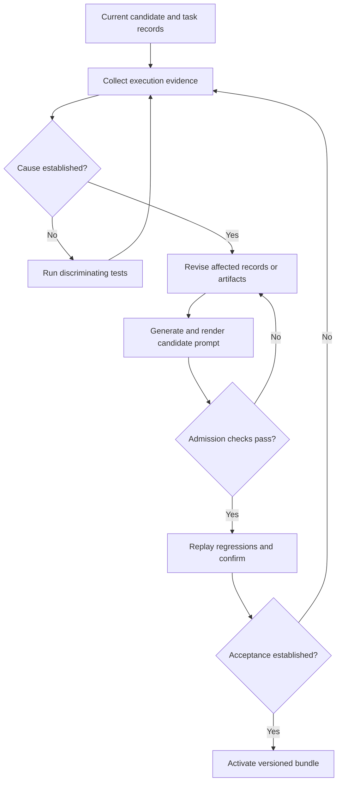

CONVERGE Prompt Update Walkthrough

From execution evidence to revised meanings, candidate wording, and accepted agent instructions.

CONVERGE generates an updated prompt by revising the structured interpretation of a task, identifying the instructions affected by that revision, proposing replacement wording, and checking the consequences. The elaborator proposes meanings and text, the evidence controller classifies feedback, the revision engine selects supported changes, and the renderer produces the instructions delivered to an agent. The verifier subsequently checks the resulting artifacts and behavior against the accepted obligations. A candidate prompt becomes part of an accepted configuration only after the applicable release checks pass.

The central problem is that a failed execution does not identify its own cause. A discrepancy can originate in generated code, an incorrect interpretation, a missing policy, an environment assumption, or a mistaken expected result. Each cause requires a different repair, and changing the task whenever the implementation struggles would conceal defects. CONVERGE therefore keeps the source of every substantive instruction and the evidence supporting each change visible throughout revision.

This walkthrough defines the prompt-update procedure, its data structures, its decision rules, and its acceptance conditions directly. The complete controller is a proposed architecture, while the Scala reference prototype described here implements a more limited prompt-compilation and routing harness. The examples explain how the procedure should operate and distinguish those design obligations from the reference prototype's actual capabilities. Prompt templates, record identifiers, sample scores, and mathematical examples are illustrative constructions rather than reported experimental results.

Every substantive operation is explained through four questions: who supplied its inputs, which component performs it, what mechanism performs the transformation, and what purpose the transformation serves. Component names describe responsibilities and do not require a separate LLM process for each role. For example, a deterministic Scala function can implement rendering or field comparison, while an LLM can propose wording through a generation API. A deployment must identify which mechanisms are actually implemented before making claims about their behavior.

The following table gives the complete dataflow before the detailed examples.

| Stage | Input source | Responsible component | Concrete mechanism | Purpose |
| --- | --- | --- | --- | --- |
| Record the task | User request and authorized configuration | Intake component | Versioned task fields and source spans | Preserve requirements and their origins |
| Propose meanings | Request, schema, contracts, and accepted evidence | Elaborator | Source-mapped typed records, optionally proposed by an LLM | Make interpretations and gaps explicit |
| Produce observations | Candidate code, inputs, and environment | Execution harness | Isolated execution, traces, diagnostics, and artifact identifiers | Establish what the candidate actually did |
| Resolve evidence | User clarifications, harness records, and domain facts | Evidence resolver | Typed records plus a declared authority and supersession policy | Separate facts, obligations, and conflicts |
| Diagnose the discrepancy | Evidence and dependency models | Diagnostic component | Competing hypotheses and discriminating tests | Locate the layer requiring repair |
| Select a revision | Defeasible assumptions and accepted constraints | Revision engine | Finite search or a solver for the declared rule fragment | Choose a supported semantic change |
| Invalidate consequences | Changed justifications and dependency edges | Dependency manager | Reachability traversal with a visited set | Prevent reuse of stale artifacts |
| Propose wording | Selected patch and preserved obligations | Rewriting component | Bounded text generation or typed-edit generation | Express the justified revision |
| Render the prompt | Admitted records and the assigned work package | Prompt renderer | Deterministic templates and accepted text fragments | Produce actual agent instructions |
| Validate and activate | Coordinated candidate and independent obligations | Verifier and activation controller | Regression replay, confirmation, freshness checks, and version-checked activation | Bind acceptance to the tested candidate |

The first step separates the prompt from the records that determine its meaning.

Suppose the user supplies the following request. The intake component records the three sentences and their source locations without silently adding a policy for every unspecified case. The elaborator then examines the request together with a schema obtained from an authorized input reader. Its purpose is to propose executable interpretations while retaining material choices that the supplied information does not resolve.

```text
For each customer, retain the latest update.
Write the result to a new file.
Do not modify the input files.
```

The word "latest" does not identify a clock. A record may contain both the time an event occurred and the time the application received it. These times can disagree because networks delay messages, devices reconnect, or batches arrive out of order. Consequently, a program can execute successfully and still implement a different meaning from the one the user intended.

The controller keeps the following representations separate. EngineerIntent records the engineer-supplied task contract, TaskIR normalizes one request, and SPECIR records accepted meanings together with obligations and unresolved gaps. The executable workflow supplies operations that realize the accepted interpretation. The rendered prompt is a view compiled from the relevant records, rather than the only place where the task's meaning exists.

| Representation | Purpose | Running example |
| --- | --- | --- |
| Original request | Preserve what the user said | "Retain the latest update" |
| Protected intent | Preserve requirements ordinary repairs cannot change | Input files remain unchanged |
| TaskIR | Normalize one task into explicit fields | Group records by customerId |
| SPECIR | Record meanings, assumptions, obligations, and gaps | Recency clock remains unresolved |
| Executable workflow | Describe operations implementing the task | Read, validate, group, select, publish |
| Rendered prompt | Instruct a particular agent | Implement the accepted selection rule |
| Evidence ledger | Record observations, clarifications, and provenance | User accepted event-time ordering |

An intermediate representation, abbreviated IR, is a structured record that makes a task's fields explicit before the controller renders prose or generates code. The engineer supplies EngineerIntent through a request or accepted configuration. The elaborator proposes TaskIR by assigning normalized operations, arguments, and resources to that intent, and the ratifier records which assignments are accepted. SPECIR, the specification intermediate representation, collects those accepted assignments together with provenance, dependencies, and unresolved obligations across the task.

A construct is a particular occurrence of a meaningful phrase in the original request. For this example, C_group identifies "for each customer," C_latest identifies "latest update," C_output identifies "new file," and C_preserve identifies "do not modify the input files." The source mapper records the clause identifier and text span for each occurrence, rather than assuming that every appearance of the same word has the same meaning. A source mapping lets the checker identify precisely which requirement supports a generated instruction and which original phrase must be revisited after a discrepancy.

The accepted meaning of a construct is a typed operation with explicit obligations. A type describes the kind of value that an operation accepts or returns; a precondition describes when it is supported; a postcondition describes what a successful result must satisfy. An effect records an allowed state change, while a frame condition records state that must remain unchanged. The binding map then associates an abstract operation, such as publishing a new result, with a specific implementation and resource contract.

| Field | Concrete meaning in the example | Supplied or checked by |
| --- | --- | --- |
| Operation | Select a maximum within one customer group | Elaborator and semantic checker |
| Input type | Nonempty group of validated records | Schema reader and type checker |
| Output type | One selected record after ties are resolved | Accepted selection policy |
| Precondition | Required timestamps parse and identifier rules hold | Domain policy and validator |
| Postcondition | No record in the group has a greater accepted key | Semantic checker and execution verifier |
| Effect | Create a fresh output resource | User authorization and effect controller |
| Frame | Input resources remain unchanged | User requirement and execution enforcement |
| Binding | Concrete parser, reader, and output-creation primitive | Resource registry and binding checker |

An obligation is a property that some named checker must establish before the controller makes a corresponding claim. For example, the grouping obligation requires one selected record per customer, while the frame obligation requires unchanged inputs. A contract is a collection of such input assumptions, output guarantees, and effect restrictions for an operation. The registry owner supplies a contract for a binding, and the controller must identify whether its guarantees are trusted, formally established, or only supported by tests.

A reasoning epoch is a versioned interval during which the assumptions used by a particular analysis remain fixed. The controller records the protected requirements, model and encoder identities, candidate grammar, contracts, and evidence policy in an epoch manifest. Ordinary observations can accumulate inside that interval, but changing a protected requirement or a premise of a claimed theorem requires a new applicable epoch or explicit revalidation of the affected claim. This prevents a guarantee established for one task and environment from silently being reused after the problem changes.

```text
Controller state at revision t:
  protectedIntent
  specificationText
  acceptedMeanings
  factualEvidence
  defeasibleDefaults
  dependencyGraph
  explanatoryHypotheses
  workflow
  resourceBindings
  testObligations
  geometryPolicy
  versionManifest
  remainingBudget
```

The controller stores these fields explicitly because a prompt string cannot reliably encode their different roles. For example, an observed output belongs to factual evidence, an intended output belongs to an accepted obligation, and a model's guess belongs to a hypothesis collection. The revision index t advances when the controller records a new candidate state, while the manifest identifies the fixed context under which that state is interpreted. The prompt renderer reads the appropriate accepted fields and work obligations when preparing the next agent invocation.

An illustrative initial record follows. The schema reader supplies the available field names, while the elaborator proposes grouping and maximum selection from the sentence structure. The checker preserves the relationship between "for each customer" and "latest" so that selection remains inside each customer group. The unresolved entries prevent a provisional model choice from being mistaken for an accepted requirement.

```text
Task:
  Select one update per customer.

Grouping:
  key = customerId

Selection:
  operation = maximum
  orderingField = UNRESOLVED
  alternatives = [occurredAt, receivedAt]

Output:
  create a new output file
  preserve selected record contents

Protected requirements:
  input files remain unchanged
  existing files must not be overwritten

Unresolved:
  which timestamp determines recency?
  what happens when event timestamps tie?
  what happens when a required timestamp is malformed?
```

If the elaborator proposes `receivedAt`, the evidence controller labels that choice as provisional unless an accepted source already establishes it. The model's generation probability can help prioritize alternatives but does not authorize a new requirement. An unresolved interpretation may be exercised through an admitted isolated probe to reveal its behavior. Such a probe does not authorize publishing its result as the completed user task.

The second step creates an input on which the competing meanings disagree.

The schema reader reports the fields `customerId`, `recordId`, `occurredAt`, `receivedAt`, and `payload`. The test generator uses those fields and the two candidate clock selectors to construct a discriminating fixture. The execution harness evaluates each admitted probe against the same fixture and records its outputs. The purpose is to make the consequences of the ambiguity concrete before the controller commits to a meaning.

All times in this first fixture refer to the same date and UTC offset.

| Record | Customer | Event time: occurredAt | Arrival time: receivedAt |
| --- | --- | --- | --- |
| R101 | C17 | 10:00 | 12:00 |
| R102 | C17 | 11:00 | 11:10 |
| R201 | C18 | 09:00 | 09:02 |

The two selectors produce different answers for customer C17. The arrival selector compares 12:00 with 11:10 and returns R101. The event selector compares 10:00 with 11:00 and returns R102. Both selectors return R201 for C18 because that customer has only one record.

```text
Latest arrival for C17:
  maximum(receivedAt)
  = maximum(12:00, 11:10)
  = R101

Latest event for C17:
  maximum(occurredAt)
  = maximum(10:00, 11:00)
  = R102
```

Before an authoritative source resolves the clock, this fixture exposes a specification question rather than establishing a defect. The evidence controller presents the competing results to the user only when existing accepted domain information cannot decide the matter. Suppose the user then states that "latest" means the update whose event occurred most recently and that arrival order must not determine recency. The controller records that clarification as an accepted semantic commitment, making R102 the expected result for this fixture.

The third step records feedback as evidence with explicit semantic roles.

The user supplies the intended interpretation, while the execution harness supplies observations about specific runs. The evidence resolver stores both through a typed ledger interface that records source, subject, version, scope, and status. It applies the declared authority policy to distinguish accepted commitments from hypotheses and to identify unresolved conflicts. This prevents an observed output from becoming a requirement merely because it appeared in a feedback message.

An illustrative clarification record is:

```text
Evidence ID:
  E17

Kind:
  Accepted semantic clarification

Source:
  User

Affected construct:
  C_latest

Accepted meaning:
  Recency is determined by occurredAt.

Discriminating input:
  R101 and R102 for customer C17.

Expected selection:
  R102

Superseded interpretation:
  receivedAt determines recency.

Requirements unaffected:
  Group by customerId.
  Preserve input files.
  Create a new output file.
```

The execution harness produces a different kind of record after running implementation V4 against fixture F7. Its observation can identify a selected record and a traced comparator field. That observation concerns a particular artifact and input, so the record retains their identifiers. It establishes behavior without independently establishing whether the behavior is desired.

```text
Evidence ID:
  E18

Kind:
  Execution observation

Implementation version:
  V4

Input fixture:
  F7

Observed selection:
  R101

Trace:
  Comparator reads receivedAt.
```

The ledger can contain E17 and E18 consistently: one states the desired meaning and the other reports an execution that differs from it. The resolver must retain this distinction when constructing context for an LLM. A compiler diagnostic, a model hypothesis, and a user clarification similarly require separate roles even when all are serialized as text. If equally authoritative records conflict and the policy supplies no justified precedence, the controller records a conflict instead of selecting whichever statement arrived last.

The evidence resolver uses an explicit policy rather than allowing the model to rank sources by confidence of expression. A user-ratified clock rule can determine task meaning, a compiler can report a type error, and a harness can establish what an execution returned. A compiler diagnostic cannot grant permission to overwrite a file, and a successful run cannot ratify its own expected answer. These distinctions are implemented as rules over record kinds, issuer authority, scope, version, and supersession links.

```text
RESOLVE_EVIDENCE(ledger, policy, currentSubject):
  validate each record's issuer and permitted claim kind
  retain observations with their original run and artifact IDs
  follow authorized supersession links for normative records
  select commitments applicable to currentSubject
  detect conflicting applicable commitments
  return active facts, accepted commitments, unresolved conflicts
```

For example, E19 may be an authorized correction stating that an earlier expected value in E17 was entered incorrectly. The resolver preserves E17 as history, marks its affected commitment superseded by E19, and invalidates conclusions that depended on that expectation. It does not erase the execution observation E18, because the old implementation still produced the recorded output on that run. The dependency manager then reconstructs the affected reasoning from the preserved base and the remaining justified evidence.

The fourth step diagnoses the layer that requires repair.

The diagnostic component reads accepted meanings, observed traces, code models, and dependency records. It proposes competing explanations through model inspection, explicit rules, or an LLM constrained to produce labeled hypotheses. The test generator then constructs scenarios on which those explanations predict different observations. The harness validates the scenarios and executes admitted probes so that the diagnosis rests on evidence rather than on the fluency of a proposed explanation.

Selecting R101 when event-time semantics requires R102 can have several causes. The following mapping determines which artifact the revision controller should target. The repair request must identify its supporting evidence and affected layer. When the evidence cannot distinguish the causes, the controller returns a measurement obligation rather than prematurely rewriting the task.

| Hypothesis | Explanation | Appropriate repair |
| --- | --- | --- |
| Wrong clock interpretation | A provisional meaning selects the latest arrival | Revise the semantic assignment |
| Wrong comparison direction | The code selects the earliest event | Repair the implementation |
| Incorrect timestamp parsing | Dates or offsets are interpreted incorrectly | Repair parsing or its binding |
| Incorrect expected result | A test oracle reflects a mistaken assumption | Supersede the unsupported oracle label |
| Missing tie policy | Equal event instants have no accepted resolution | Resolve the semantic gap |

For a concrete diagnostic example, suppose three hypotheses survive. H1 chooses the greatest arrival time, H2 chooses the greatest event time, and H3 chooses the smallest event time. The first fixture distinguishes H2 from the other two but does not distinguish H1 from H3. Observing R101 alone therefore does not identify a unique cause.

| Hypothesis | Prediction on the first fixture |
| --- | --- |
| H1: greatest receivedAt | R101 |
| H2: greatest occurredAt | R102 |
| H3: smallest occurredAt | R101 |

The test generator adds a second fixture in which both clocks increase in the same order. The harness uses the same customer and valid timestamp domain for both records. This fixture separates an earliest-event implementation from the two maximum selectors. Together, the fixtures distinguish the three modeled hypotheses, although they do not establish that the hypothesis collection is exhaustive.

| Record | Event time | Arrival time |
| --- | --- | --- |
| R301 | 10:00 | 10:01 |
| R302 | 11:00 | 11:01 |

| Hypothesis | Prediction on first fixture | Prediction on second fixture |
| --- | --- | --- |
| H1 | R101 | R302 |
| H2 | R102 | R302 |
| H3 | R101 | R301 |

The scheduler uses a pairwise disagreement score to prioritize tests that separate competing explanations. The diagnostic component supplies a finite set of hypotheses, and each model supplies its predicted observable result for a scenario. The scheduler counts pairs with different predictions and divides by the number of unordered pairs. This score measures disagreement within the current hypothesis collection, rather than the probability that a scenario reveals the true explanation.

```text
m = number of surviving hypotheses
x = proposed scenario

totalPairs = m * (m - 1) / 2

disagreement(x) =
  disagreeing hypothesis pairs / totalPairs

For m < 2:
  define disagreement(x) = 0
```

With three hypotheses, `totalPairs = 3 * 2 / 2 = 3`. In the first fixture, H1 disagrees with H2, H2 disagrees with H3, and H1 agrees with H3. Therefore, the score is `2 / 3`. The scheduler can combine that score with execution cost and uncovered obligations while retaining exploration beyond the currently modeled hypotheses.

The fifth step selects a supported semantic revision.

Suppose E17 establishes event-time semantics and E18 shows that the current implementation follows the provisional arrival-time meaning. The revision engine reads these records together with the preserved assumption base and protected requirements. It searches for an admissible replacement interpretation using the declared finite rule language and selection policy. The purpose is to change the defeated meaning while preserving independently justified requirements.

An illustrative typed patch follows. The elaborator may propose its fields, but the external checker must verify their provenance and compatibility with the accepted task. The unresolved policies remain explicit because the clock clarification does not determine them. The patch provides the structured input from which subsequent wording and artifact changes can be generated.

```json
{
  "affectedConstruct": "C_latest",
  "previousMeaning": {
    "operation": "maximum",
    "field": "receivedAt",
    "status": "provisional"
  },
  "replacementMeaning": {
    "operation": "maximum",
    "field": "occurredAt",
    "comparison": "chronological instant"
  },
  "evidence": ["E17", "E18"],
  "preservedRequirements": [
    "group by customerId",
    "preserve input files",
    "create a new output file"
  ],
  "remainingQuestions": [
    "equal event-time policy",
    "malformed timestamp policy"
  ]
}
```

The revision engine needs a precise meaning for a defeasible default. A default is a rule that licenses a conclusion when its prerequisite is established and its justification remains consistent with the proposed completed interpretation. It differs from a hard requirement because later evidence can defeat its use without changing the protected task. The rule author supplies its prerequisite, justification, conclusion, and provenance; the rule validator decides whether the proposed use is permitted.

```text
Default rule:
  d = (alpha : beta / gamma)

alpha:
  Prerequisite that must already be derivable.

beta:
  Justification that must remain consistent with the candidate
  completed interpretation.

gamma:
  Conclusion licensed by the rule.

The colon and slash separate rule fields; they are not arithmetic.
```

For the clock example, define InitialClockGap(c) to mean that the original occurrence c did not specify a clock. Define Arrival(c) to mean that its selector uses arrival time, and Event(c) to mean that it uses event time. A provisional rule can license Arrival(c) from InitialClockGap(c), provided Arrival(c) remains consistent with the completed interpretation. An exclusivity axiom states that Event(c) and Arrival(c) cannot both be the chosen primary clock.

```text
d_arrival = (
  InitialClockGap(c) : Arrival(c) / Arrival(c)
)

Before clarification:
  InitialClockGap(c) is established.
  No accepted commitment excludes Arrival(c).
  The arrival default can support a provisional interpretation.

After accepted event-time clarification:
  Event(c) is established.
  The exclusivity axiom entails NOT Arrival(c).
  The arrival default's justification is defeated.
  The old rule can remain stored without producing Arrival(c).
```

The phrase "completed interpretation" is important because checking a default against only the facts available at an early intermediate step can license a conclusion that conflicts with later consequences of the same candidate. The engine therefore validates a candidate extension against itself. An extension is a set of conclusions that can be regenerated from the hard base and applicable defaults when their justifications are checked against that same set. A merely satisfiable assignment may contain unsupported conclusions, so satisfiability alone does not establish extension validity.

For a finite propositional implementation, let W be the hard base, D the finite default set, and X a proposed consistent extension. Let Cn(B) mean the classical consequences of base B over the declared finite atom vocabulary; an implementation represents this closure through models or a finite canonical encoding rather than listing every equivalent formula. The validator starts with the consequences of W and repeatedly adds licensed rule conclusions. It checks every justification against X, while checking prerequisites against the growing derived set Y.

```text
VALID_EXTENSION(W, D, X):
  require X is consistent
  Y = Cn(W)

  repeat:
    additions = all gamma from rules (alpha : beta / gamma)
                where Y entails alpha
                and X does not entail NOT beta

    nextY = Cn(Y union additions)
    if nextY is logically equivalent to Y:
      return X is logically equivalent to Y
    Y = nextY
```

The fixed-point comparison prevents an arbitrary unsupported assertion from entering X. For example, if no hard fact or applicable rule licenses a permission to overwrite the input, adding that permission to a candidate does not make it a valid extension. With a finite atom vocabulary, classical entailment can be decided by enumerating truth assignments, although this can be expensive. With finitely many default conclusions, the inner loop can introduce only finitely many distinct conclusions before it stabilizes.

The outer validator can enumerate subsets of rule conclusions, close each subset together with W, and test the resulting candidate X. For m defaults there are at most 2^m subsets of conclusions, with duplicate closures discarded. This construction establishes a finite search procedure for the declared fragment, not practical scalability for arbitrary natural-language rules. An optimized solver can replace enumeration only if it preserves the chosen semantics or reports the limits of its search.

Conflicting defaults can produce multiple valid extensions. For example, equally eligible arrival and event defaults plus the exclusivity axiom can support two separate interpretations. The controller must preserve the alternatives or apply an explicitly authorized selection rule; it cannot combine their incompatible clock choices into one accepted meaning. An accepted event-time fact removes the arrival alternative by defeating its justification, while the original input-preservation requirement remains hard in both cases.

The proposed finite revision operator can rank feasible alternatives using explicit removal, addition, and representation costs. The policy owner supplies the weights and the allowed assumption pool, while the revision engine performs the search. Accepted requirements enter as constraints rather than preferences that the optimizer can trade away for a cheaper change. A candidate that retains arrival-time semantics after E17 is infeasible regardless of its low editing cost.

```text
D_new = (D0 minus R) union A

cost(R, A, X) =
    sum(w_remove(d) for d in R)
  + lambda * sum(w_add(a) for a in A)
  + eta * size(X)
```

| Variable | Meaning |
| --- | --- |
| D0 | Preserved default-assumption base for the reasoning epoch |
| R | Defaults proposed for removal |
| A | Replacement assumptions selected from a declared finite pool |
| D_new | Resulting default set |
| X | Consistent extension or interpretation under the declared default semantics |
| w_remove(d) | Policy cost of removing default d |
| w_add(a) | Policy cost of adding assumption a |
| lambda | Weight applied to addition costs |
| eta | Weight applied to representation complexity |
| size(X) | Size of a declared finite canonical representation of X |

For illustration, let removing the arrival default cost 2, adding an event-time default cost 1, `lambda = 1`, `eta = 0.1`, and the resulting representation size be 3. This candidate has cost `2 + 1 * 1 + 0.1 * 3 = 3.3`. The calculation evaluates one candidate; it does not prove that the candidate is optimal. The engine must compare all relevant feasible alternatives, or report that its search is incomplete.

There is a further distinction between defeating a conclusion and deleting its rule. If an accepted event-time fact makes the arrival default inapplicable under the declared default semantics, the old rule can remain dormant without licensing the wrong interpretation. Physically removing that rule and adding another default may therefore be unnecessary and more expensive. The engine must compare this dormant-rule alternative with physical replacement before claiming a minimum, so 3.3 is only the cost of the particular replacement being illustrated.

Canonical revision also requires a stable optimization problem. The controller fixes the epoch base, admissible candidate construction, weights, evidence policy, and tie-break rule when claiming a canonical result. A local repair procedure that optimizes against the current state can be useful, but its answer may depend on the order in which evidence arrived. The implementation must distinguish those policies instead of claiming order independence for an arbitrary sequence of prompt edits.

The finite revision search can now be specified without an undefined "repair" operation. The policy supplies D0, a finite pool A0 of allowed replacement assumptions, nonnegative costs, and a fixed tie-break order. The engine enumerates each removal subset R of D0 and addition subset A of A0, constructs D_new, and asks the extension validator for admissible interpretations. It discards candidates failing protected intent, accepted commitments, types, authority, or other mandatory constraints before comparing their costs.

```text
SELECT_REVISION(hardBase, D0, A0, policy):
  feasible = empty
  for each R contained in D0:
    for each A contained in A0:
      D_new = (D0 minus R) union A
      for each valid consistent extension X of (hardBase, D_new):
        if mandatory admission constraints hold for X:
          record (R, A, X, cost(R, A, X)) in feasible

  if enumeration was interrupted:
    report SearchIncomplete and any provisional candidates
  else if feasible is empty:
    report NoRevisionInDeclaredUniverse
  else:
    return the minimum-cost candidate under the fixed tie-break
```

If D0 contains k defaults and A0 contains j replacement assumptions, the subset search contains at most `2^k * 2^j` removal-and-addition combinations before extension validation. The input counts k and j describe the declared search space, not the length of the English prompt. A timeout can leave a useful feasible candidate but cannot establish that it is globally cheapest. A controller using a local search mode may accept such a candidate under that mode's policy, while withholding a canonical-minimum claim.

The sixth step invalidates the consequences of the defeated interpretation.

The dependency manager reads the changed justification nodes and the graph that links assumptions to meanings, code, expectations, and certificates. It performs a reachability traversal, using a visited set to handle cycles, and marks reachable current justifications stale. Negative dependencies also matter when a rule's applicability depends on the absence of a conflicting conclusion. The purpose is to prevent an old result from surviving merely because its originating assumption was changed elsewhere.

| Artifact | Dependency | Required treatment |
| --- | --- | --- |
| Arrival-time selector | Defeated clock interpretation | Mark stale |
| Comparator using receivedAt | Arrival-time selector | Regenerate or repair |
| Expected output R101 | Arrival-time interpretation | Supersede as a normative expectation |
| Earlier acceptance certificate | Old implementation and oracle | Mark stale |
| Customer grouping | Original grouping requirement | Preserve if independently justified |
| Input protection | Original prohibition | Preserve |
| New-file requirement | Original output requirement | Preserve |

The graph traversal has a concrete implementation even when the graph contains cycles. The dependency manager initializes a queue with the changed justifications and records every visited node in a set. For each node it removes from the queue, it marks that justification stale and enqueues its dependents that have not yet been visited. A finite graph then requires at most one visit per node and one examination per outgoing edge of a visited node.

```text
INVALIDATE(changedNodes, dependents):
  queue = changedNodes
  visited = empty set
  while queue is not empty:
    node = remove one item from queue
    if node is not in visited:
      add node to visited
      mark node's current justification stale
      append dependents(node) to queue
  return visited
```

This procedure is conservative only if the graph contains every relevant dependency. To see why, consider any justification that relies on a changed premise through a finite chain. Traversal reaches the first dependent, then the next, and eventually the entire chain, so the final justification becomes stale before reuse. A missing edge breaks that argument, which is why dependency completeness is an explicit assumption and must include consistency conditions as well as ordinary data dependencies.

Invalidating a justification does not always delete the underlying artifact permanently. An independent justification may allow the dependency manager to re-establish part of the state after recomputation. Conversely, a previously passing test whose expected answer depended on arrival-time semantics cannot remain a mandatory correctness condition after that meaning is defeated. The controller preserves still-valid obligations rather than treating every historical expected answer as immutable.

The seventh step asks a rewriting component to express the selected change.

The revision engine supplies a selected semantic patch, and the evidence resolver supplies its accepted supporting records. The rewriting component receives those inputs together with the current clause, protected requirements, permitted edit scope, and unresolved questions. Through an LLM generation call or a typed-edit procedure, it proposes replacement wording and source mappings. Its purpose is to express the justified change without silently reconstructing the entire task from incomplete context.

The following is an illustrative instruction package for that component. It specifies the exact task context, permitted changes, and response fields for one bounded rewriting call. An implementation can request a structured response containing patch fields, proposed wording, evidence identifiers, and unresolved obligations. The checker must still validate those fields after parsing the response.

```text
Produce a candidate revision for construct C_latest.

Current clause:
  For each customer, retain the latest update.

Current provisional interpretation:
  Select the record with the greatest receivedAt value.

Accepted clarification E17:
  Latest means the event that occurred most recently.
  Arrival order must not determine recency.

Required replacement meaning:
  Within each customerId group, select records having the
  greatest occurredAt instant.

Preserve:
  Group by customerId.
  Preserve input files.
  Write results to a new output file.
  Preserve the contents of selected records.

Permitted changes:
  Replace the clock-selection interpretation.
  Add implementation obligations needed for chronological
  timestamp comparison.
  Identify consequences of the replaced interpretation.

Unresolved policies:
  Equal event times.
  Malformed required timestamps.

Return:
  A structured semantic patch.
  Replacement wording.
  Evidence supporting each added instruction.
  Dependencies requiring regeneration.
  Remaining unresolved questions.

Do not invent answers to unresolved policies.
Do not broaden the permitted effects.
```

The controller can examine several wording candidates against the same accepted patch. Some candidates may contradict the clock clarification, omit grouping, or change the effect boundary. A candidate that hard-codes R102 can reproduce the motivating example without implementing the general rule. The checking mechanism therefore compares the proposed meaning and resulting behavior with the accepted obligations, rather than selecting text solely because it mentions familiar words.

| Candidate | Assessment |
| --- | --- |
| For each customerId, select the record with the greatest occurredAt instant. | Expresses the accepted clock and grouping; ties still require resolution |
| Select the most recently received update for each customer. | Contradicts E17 |
| Select the record with the greatest occurredAt value. | Leaves grouping unstated in isolation; inspect its full context |
| Keep R102 whenever R101 and R102 occur together. | Memorizes the fixture without stating the general rule |
| Remove older records from the input file. | Violates input preservation |

An LLM is not required to author every sentence. A deterministic renderer can insert accepted values into a template such as the following. The application supplies the template, the admitted task record supplies the values, and string interpolation performs the substitution. This makes the origin of each inserted instruction inspectable.

```text
Template:
  For each {groupingKey}, select the record maximizing
  {orderingField} interpreted as {comparisonMeaning}.

Accepted fields:
  groupingKey = customerId
  orderingField = occurredAt
  comparisonMeaning = a chronological instant

Rendered clause:
  For each customerId, select the record maximizing
  occurredAt interpreted as a chronological instant.
```

The proposed architecture can combine LLM-authored clauses with deterministic rendering. The Scala reference prototype relies heavily on deterministic templates after its task fields have passed external checks. In both cases, the final words come from retained strings or template substitutions. The embedding component scores textual candidates but does not supply an inverse operation that turns a target vector into the intended sentence.

The eighth step checks semantic obligations and geometric bounds.

The admission checker receives the candidate patch and wording from the rewriting component, along with the protected intent and accepted semantic records from the controller. It checks the supported formal properties, authority rules, type constraints, and explicit prohibitions using the declared checking mechanisms. Unsupported properties remain unresolved obligations rather than becoming successful checks by default. The purpose is to reject candidates whose attractive wording hides a changed task.

For example, "Do not overwrite the input file" and "Overwrite the input file" concern the same resource and action but authorize opposite behavior. An embedding encoder can assign them nearby vectors. The authority and effect checks must therefore examine the prohibition directly. Geometric proximity alone cannot establish that the replacement is admissible.

The geometric checker supplies an additional bound on candidate movement. The controller records a fixed encoder configuration, canonical clause context, reference vector, and permitted radii. The embedding service maps each candidate string to a vector, and deterministic numerical code normalizes the vector and computes distances. A complete geometric checker must reject or separately handle zero or nonfinite vectors because they do not provide valid normalized-distance evidence. The reference prototype does not enforce every one of these stronger validity checks, so the complete checker described here is an additional implementation obligation.

```text
z0:
  Unit-normalized embedding of the epoch's reference clause.

zt:
  Unit-normalized embedding of the current clause.

znew:
  Unit-normalized embedding of a candidate clause.

R:
  Maximum permitted distance from the reference.

r:
  Maximum permitted distance from the current clause.

Required bounds:
  distance(znew, z0) <= R
  distance(znew, zt) <= r
```

For unit vectors, Euclidean distance and cosine similarity are related by the following derivation. The squared norm of a difference expands into two squared norms and a dot product. Each squared norm equals 1 after normalization, and the dot product equals cosine similarity. Taking the nonnegative square root gives the distance used in this example.

```text
distance(a, b)^2
  = norm(a - b)^2
  = norm(a)^2 + norm(b)^2 - 2 * dot(a, b)
  = 1 + 1 - 2 * cosineSimilarity(a, b)
  = 2 * (1 - cosineSimilarity(a, b))

distance(a, b)
  = sqrt(2 * (1 - cosineSimilarity(a, b)))
```

The variables `a` and `b` denote the two unit vectors being compared. Euclidean distance satisfies the triangle inequality required by the drift argument. The quantity `1 - cosineSimilarity(a, b)` induces the same ranking on unit vectors but is not generally a metric. The implementation must use the quantity required by the stated theorem rather than substituting a convenient similarity score.

Suppose the policy uses the illustrative bounds `R = 0.30` and `r = 0.25`. A candidate with reference similarity 0.96 has reference distance `sqrt(0.08)`, approximately 0.283. If its current-clause similarity is 0.98, its local distance is `sqrt(0.04) = 0.200`. It passes both bounds, although semantic admission remains a separate requirement.

| Candidate | Similarity to reference | Distance from reference | Similarity to current | Distance from current | Geometric result |
| --- | --- | --- | --- | --- | --- |
| A | 0.96 | 0.283 | 0.98 | 0.200 | Pass both bounds |
| B | 0.93 | 0.374 | 0.99 | 0.141 | Fail reference bound |

Candidate B shows why a small local edit does not imply bounded cumulative drift. A long sequence of locally small moves can leave the original neighborhood. The fixed reference bound limits that displacement at every accepted step. Actual radii require a declared calibration procedure, and the numerical values in this table are illustrative rather than recommended settings.

The cumulative bound follows directly from the two acceptance conditions. If every admitted vector is checked against the fixed reference z0 with radius R, every admitted state is within R of that reference by construction. With only a local radius r, the triangle inequality gives `distance(zn, z0) <= n * r` after n moves. On the real line, successive moves of length r achieve that bound; on the unit sphere the distance is capped at 2, but can still leave any smaller intended neighborhood.

The calibration owner supplies a separate collection of approved elaborations and labeled scope changes for each relevant clause context. The geometric checker measures distances under the frozen encoder, and the calibration procedure chooses radii according to a declared tradeoff between excluding useful rewrites and admitting misleading ones. For example, increasing R may admit more valid elaborations while also admitting sentences that reverse a prohibition. The controller retains explicit semantic checks because no empirical distance threshold establishes the meaning of every unseen sentence inside the region.

If all semantically correct candidates lie outside the declared radius, the controller cannot quietly increase the radius and retain the old guarantee. An authorized re-anchoring or changed bound starts a new applicable geometric configuration and triggers the required revalidation. A complete search of the bounded candidate universe can establish that no admissible realization exists there. A sampled search that finds none can establish only that its own search did not succeed.

The ninth step renders the candidate prompt for a particular worker.

The prompt renderer reads admitted task fields, protected requirements, the assigned role, the current repair package, and relevant evidence. It assembles the worker's instructions through templates and accepted text fragments. This operation produces a concrete prompt string whose instructions can be traced back to their sources. A role-specific prompt can include only the relevant portion of the complete state, provided that this selection preserves the obligations needed for the assigned work.

The following notation uses `U_t` for the rendered prompt at revision `t`. The index t counts revisions, and the executable workflow remains a separate object containing operations, arguments, and resource bindings. `Render` denotes the application procedure that assembles text, not a claim that one universal prompt template solves every task. Its inputs describe the information that the procedure must account for.

```text
U_t = Render(
  accepted task meaning,
  protected requirements,
  assigned role,
  authorized resources and effects,
  current repair obligations,
  relevant evidence,
  required completion evidence
)
```

After accepting event-time semantics, the renderer could produce the following candidate prompt. The accepted clarification supplies the clock rule, the schema supplies timestamp structure, and the original request supplies grouping and input protection. The unresolved tie and malformed-input policies remain visible. Consequently, this prompt can guide development and probes without pretending that the release specification is complete.

```text
Implement the customer-update selection task.

For each distinct customerId, select the record whose
occurredAt timestamp represents the latest chronological
instant.

Interpret timestamps using their dates and explicit offsets.
Normalize them to comparable instants before comparison.
receivedAt must not determine recency.

Preserve all input files and the contents of selected records.
Write results to a new output file without replacing an
existing file.

The equal-event-time policy and malformed-timestamp policy
remain unresolved. Report these gaps instead of silently
introducing a policy.

For the supplied discriminating fixture, customer C17 must
select R102 because its event occurred at 11:00, later than
R101's event at 10:00.

Provide the implementation, validation results, and the list
of unresolved obligations.
```

The fixture supplements the general rule rather than replacing it. The test generator should also construct different identifiers and times so that a worker cannot satisfy the task by special-casing R101 and R102. The verifier evaluates the predicates established by the accepted semantics, including one selection per customer and unchanged inputs. A prompt that states the correct rule does not establish that generated code follows it.

The tenth step uses a new failure to repair implementation without changing meaning.

Suppose the worker generates a comparator that orders timestamp strings. The execution harness runs it against the first fixture and observes the expected result because the relevant timestamps share a compatible representation and offset. The test generator then supplies a fixture with different explicit offsets, justified by the accepted chronological interpretation and schema. The harness records a failure when raw-string or displayed-hour comparison chooses the wrong instant.

| Record | occurredAt | Normalized instant |
| --- | --- | --- |
| R401 | 2026-11-01T10:00:00+02:00 | 2026-11-01T08:00:00Z |
| R402 | 2026-11-01T09:30:00Z | 2026-11-01T09:30:00Z |

R402 is later because 09:30 UTC follows 08:00 UTC. Subtracting the two-hour offset explains the first normalization in this particular example. A real parser must also handle dates, supported ranges, and error behavior according to its contract. The diagnostic component classifies an incorrect selection here as an implementation defect once the clock meaning and supported timestamp domain are established.

The revision controller preserves the accepted meaning and creates a scoped repair obligation. The renderer includes the observed defect, expected result, permitted repair, and required regressions in the next worker prompt. This changes the worker's immediate instructions without changing the user's definition of recency. The distinction prevents a test failure from causing unnecessary specification drift.

```text
Repair the timestamp comparator.

The accepted event-time selection rule remains unchanged.

Observed defect:
  The implementation selected R401 for the offset fixture.

Required result:
  R402, because 09:30 UTC is later than 08:00 UTC.

Required repair:
  Parse supported timestamps into chronological instants.
  Compare the resulting instants.
  Do not compare raw timestamp strings or displayed hours.

Preserve grouping, input protection, and output-creation
requirements.

Rerun the offset fixture and all still-valid applicable
regression tests.
```

An updated prompt can therefore carry a new counterexample while retaining the same task semantics. Other updates can change a resource binding or request additional evidence without redefining the goal. The controller records which category occurred so that the verifier applies the correct obligations. Treating every prompt edit as a change of requirements would erase these useful distinctions.

The eleventh step resolves missing policies and incorporates their consequences.

The test generator next constructs two records whose timestamp strings differ but whose event instants are equal. The harness confirms the equality after normalization. Because the task requires one update per customer, the semantic controller checks whether an accepted tie rule already exists. If none exists, it reports the unresolved choice rather than allowing the worker to use input order as an unrecorded convention.

| Record | Event time | Normalized instant |
| --- | --- | --- |
| R501 | 2026-11-01T08:00:00Z | 2026-11-01T08:00:00Z |
| R502 | 2026-11-01T10:00:00+02:00 | 2026-11-01T08:00:00Z |

Assume the user accepts the following additional policies for this example. Equal event instants are resolved by choosing the lexicographically greatest record identifier. Record identifiers must be unique throughout the accepted input, and malformed required timestamps or duplicate identifiers cause rejection before output publication. The evidence controller records these as newly accepted policies; none follows from the word "latest" alone.

The elaborator now derives a two-component key, and the renderer expresses it in the worker prompt. The code generator implements lexicographic comparison by comparing the first component before consulting the second. Identifier uniqueness ensures a unique maximum in every nonempty customer group under this key. If the domain did not provide uniqueness, another accepted rule or a different input contract would be necessary.

```text
key(record) = (
  normalized occurredAt instant,
  recordId
)

Comparison:
  First compare the event instants.
  If they differ, choose the later instant.
  If they are equal, choose the lexicographically greater
  recordId.
```

The functional obligation can also be expressed independently of any generated program. Let X be the finite validated input collection, X_c the records whose customerId equals c, and C_X the distinct customer identifiers present in X. Let N parse a supported timestamp into an instant on a common time scale. Define K(r) as the pair containing N(r.occurredAt) and r.recordId, and let winner(X_c) be the record with the greatest K under the accepted lexicographic order.

```text
X_c = records r in X with r.customerId = c
C_X = distinct customerId values occurring in X
K(r) = (N(r.occurredAt), r.recordId)

Required output Y:
  count(Y) = count(C_X)
  for every c in C_X:
    exactly one y in Y has customerId = c
    that y equals winner(X_c)

Separate frame and effect obligations:
  all protected input contents remain unchanged
  completed output is published only at a fresh destination
```

The maximum exists because every X_c is finite and nonempty and the accepted key order is total on valid inputs. The maximum is unique because the identifier rule prevents two distinct valid records from sharing the same full key. Generating exactly one such winner for each c gives `count(C_X)` output records, and the cardinality condition excludes additional invented records. For empty valid input, C_X and Y are both empty; the output format and publication binding still determine how an empty result is represented.

The workflow implements this obligation by validating the input, grouping by customerId, computing each key, and selecting each group's maximum. A proof for this workflow depends on the parser, grouping operation, comparison, and serializer satisfying their declared contracts. The no-overwrite property requires an output-creation operation whose success contract excludes replacing an existing resource, including concurrent creation by another process. Checking that a path is absent and then opening it with overwrite enabled does not establish that property because another process can create the path between those operations.

The renderer can now emit a more complete candidate prompt. Every added policy is supported by accepted evidence, and each implementation obligation is connected to the corresponding meaning. The output resource binding must implement the required no-overwrite and publication behavior; a sentence in the prompt cannot create a missing storage guarantee. Where the resource lacks the required primitive, the binding controller must resolve that obligation before release.

```text
Implement customer-update selection for the accepted schema.

Input fields:
  customerId
  recordId
  occurredAt
  receivedAt
  payload

Validate the entire input before publishing a result:
  Required timestamps must parse using their explicit dates
  and offsets.
  Record identifiers must satisfy the accepted uniqueness rule.

If validation fails:
  Report the invalid records.
  Do not publish a completed output.
  Leave input files unchanged.

For valid input:
  Group records by customerId.
  Normalize occurredAt values to chronological instants.
  Select one record per group using this comparison key:
    first, greatest occurredAt instant;
    second, lexicographically greatest recordId.

receivedAt does not participate in the selection key.

Preserve the contents of selected records.
Create a new output without overwriting an existing file.
Leave all input files unchanged.

Validate:
  Event order differs from arrival order.
  Different timezone offsets.
  Equal event instants.
  Multiple customers.
  Malformed required timestamps.
  Duplicate identifiers.
  Existing output destination.
  Input preservation.

Report:
  The implementation version tested.
  The actual validation outcomes.
  Remaining unsupported assumptions or failed obligations.

Claim completion only when the required acceptance checks
have passed for the reported implementation.
```

The following mapping allows a reviewer to trace the new instructions. The renderer can retain these references as structured metadata even when it omits the identifiers from the user-facing wording. The verifier uses the same mapping to identify which evidence or dependency changes make an obligation stale. This connection between wording, authority, and validation gives the updated prompt a reviewable basis.

| Instruction | Source |
| --- | --- |
| Group by customerId | Original task and accepted schema |
| Select by occurredAt | Accepted event-time clarification |
| Compare chronological instants | Accepted meaning and timestamp domain |
| Use recordId for ties | Accepted tie policy |
| Reject duplicate identifiers | Accepted domain and error policy |
| Preserve input files | Original protected requirement |
| Create a new output | Original protected requirement |
| Test offset handling | Witnessed implementation failure |
| Report actual validation outcomes | Completion and evidence policy |

The twelfth step validates and activates a coordinated version.

The controller assembles a candidate containing compatible versions of the specification, meanings, prompt, code, tests, bindings, and manifest. It computes an identifier from a declared canonical serialization and associates each check with the exact artifacts examined. The verifier reads the candidate and the applicable obligations, then runs or checks the required evidence-producing procedures. The activation controller checks freshness immediately before making the candidate active.

```text
Illustrative candidate bundle:
  specification version S8
  semantic assignment version M8
  rendered prompt version U8
  implementation revision C12
  test-oracle version T6
  resource-binding version B3
  evidence manifest V8
```

The verifier returns PASS, FAIL, or UNKNOWN for each declared obligation. PASS means that the chosen check established its stated property under its assumptions, while FAIL requires a justified discrepancy. UNKNOWN covers incomplete search, missing contracts, unsupported formal fragments, timeouts, and unresolved authority. The release controller requires PASS for every mandatory obligation and does not turn an absent counterexample into a proof.

| Check result | Interpretation | Release consequence for a mandatory obligation |
| --- | --- | --- |
| PASS | Declared property established under stated assumptions | May proceed if other gates pass |
| FAIL | Justified violation or counterexample | Repair or reject |
| UNKNOWN | Required result remains unresolved | Keep release blocked |

The verifier also distinguishes development evidence from reserved confirmation. Development cases can guide repeated repairs, while confirmation assesses the frozen candidate under a separately declared policy. If the controller uses a confirmation failure to change the candidate, that evidence becomes part of development history and cannot be reused as untouched confirmation for the next version. Independence concerns the provenance and use of evidence, not simply whether two prompts were sent to different LLMs.

The activation controller must prevent validation of one version from being applied to another. A version check can reject activation if the source or relevant policy changed after verification. Where the resource supports it, a compare-and-swap or equivalent atomic activation mechanism can bind the checked predecessor to the installed candidate. External effects require their own contracts because an email, payment, or remote mutation is not automatically reversible through a local bundle replacement.

If accepted evidence invalidates the current candidate, the controller marks the affected configuration stale and restricts further dependent execution. Retaining its prompt and traces in the ledger preserves history but does not authorize continued use of a defeated interpretation. The release certificate states the checked properties, assumptions, and artifact versions. The proposed control loop is shown below, with diagnostic uncertainty and rejected candidates represented explicitly.



A second example explains prompt updates for repository maintenance and agent routing.

Assume the project owner supplies an authority configuration assigning dependency declarations in `build.sbt` to BuildAgent and application API adaptation to SourceAgent. The user requests a specified dependency-version change followed by `sbt test`. The intake component records the exact coordinate and versions from the request, and the repository reader supplies the current declaration. The router's task is to select the owner of this operation under that configuration; the artifact name alone does not establish ownership in every project.

The controller distinguishes four texts with different recipients and purposes. A routing request describes the operation to the router, while a specialist prompt supplies the selected worker's concrete obligations. Persistent catalog descriptions explain ownership boundaries across many requests. A scoped repair instruction addresses a particular discrepancy without necessarily changing any durable ownership policy.

| Text | Recipient | Purpose |
| --- | --- | --- |
| Routing request | Router | Select the authorized owner |
| Specialist prompt | Selected worker | Define the assigned work and evidence |
| Agent description | Router's persistent catalog | Describe ownership boundaries |
| Repair instruction | Rewriter or worker | Address a witnessed discrepancy |

The phrase "Fix the dependency problem" may attract either agent because dependency failures can concern declarations or source usage. The renderer can elaborate the request using the accepted operation and artifact fields. For example, it can state that the task changes an existing dependency version declaration in `build.sbt` and that source API adaptation is separate. This expansion makes already accepted distinctions explicit rather than creating a new ownership policy.

The specialist renderer can then create this prompt. The user-supplied task contract supplies the old and new versions, the authority configuration supplies the owner, and the write policy supplies the path restriction. The required command and evidence policy determine the validation instructions. The worker must still execute the permitted operations and produce actual evidence before the verifier can accept completion.

```text
You are BuildAgent.

Update only the specified dependency version in build.sbt,
from the supplied old version to the supplied new version.

Preserve unrelated dependency declarations and settings.
Do not modify application source files.

Run sbt test against the resulting candidate.
Record the command, exit status, and relevant diagnostics.

If failures require application API changes, report the
required handoff to SourceAgent.

Claim completion only when the required evidence is available.
```

The Scala reference prototype supplies a bounded, concrete prompt-generation procedure.

In the reference prototype, `PromptCompiler.compile` requests a TaskIR proposal, `Ratifier.checkTask` compares its fields with the supplied intent, and the canonicalizer and renderer prepare accepted fields for string interpolation in `PromptRenderer.scala`. The engineer-supplied `EngineerIntent` already contains rich normalized task fields. The compiler asks the model to reproduce the corresponding TaskIR values, and the external ratifier compares its output with the authoritative input. After acceptance, canonicalization restores the authoritative values and ordering, and Scala interpolation produces the routing request and specialist prompt.

| Stage | Input source | Actor and mechanism | Purpose |
| --- | --- | --- | --- |
| Load intent | Engineer configuration | Input loader and structural checks | Establish the declared task fields |
| Propose TaskIR | Authoritative intent | PromptCompiler.compile and model generation | Produce a structured proposal |
| Check fields | Proposal and original intent | Ratifier.checkTask | Reject added, removed, or altered values |
| Retry if allowed | Ratifier deviations | Bounded compiler proposal loop | Correct a rejected proposal |
| Canonicalize | Admitted proposal and original intent | Deterministic canonicalization | Restore authoritative values and order |
| Render | Canonical TaskIR and selected phrases | Scala string interpolation | Create routing and specialist text |

The reference prototype's model adapter is `OllamaClient.generateJson`. It sends a generation request with system and user prompts, a JSON schema, seed, temperature, top-p, and context limit; the snapshot also requests nonstreaming output. The adapter parses the response as JSON, after which Scala code performs call-specific checks. A schema-shaped response establishes a formatting boundary, while the ratifier supplies the relevant external field comparisons. These operations define the behavior of this reference adapter; a deployment must separately verify the request and response contracts supported by its chosen model server.

Suppose the authoritative write set contains only `build.sbt`, but the model adds `src/main/scala/**`. The ratifier's normalized-set comparison detects the extra scope and rejects the proposal. The compiler can include the deviation in another bounded attempt, asking for exactly the accepted fields. If the attempt budget is exhausted, the controller reports rejection rather than rendering the last invalid proposal.

```text
Authoritative allowed writes:
  build.sbt

Rejected model proposal:
  build.sbt
  src/main/scala/**

Repair feedback:
  The proposed allowed-write set differs from the authoritative
  allowed-write set. Remove the added source-file scope and
  return exactly the accepted task fields.
```

This procedure performs checked copying because the normalized task facts are already present in the input. The result demonstrates proposal admission and field preservation, but it does not establish general ambiguity resolution from arbitrary English. A deterministic conversion from EngineerIntent can produce the same admitted values without a model call. The renderer's output likewise does not establish that a later tool-bearing agent will obey it.

The ratifier's operation can be understood through a deterministic comparison procedure. The engineer supplies canonical scalar fields such as owner and operation and collection-valued fields such as allowed writes. The ratifier trims scalar strings, normalizes collection values according to its declared set policy, and reports each difference between the proposal and the authoritative intent. After all comparisons succeed, the canonicalizer uses the original authoritative values rather than allowing harmless formatting variation to create a new task version.

```text
CHECK_TASK(intent, proposal):
  deviations = empty
  for each required scalar field f:
    if trim(proposal[f]) != trim(intent[f]):
      record deviation for f
  for each required set-valued field f:
    if normalizeSet(proposal[f]) != normalizeSet(intent[f]):
      record deviation for f
  return deviations

COMPILE_TASK(intent, attemptBudget):
  feedback = empty
  repeat at most attemptBudget times:
    proposal = request structured TaskIR from the model
               using intent and previous feedback
    feedback = CHECK_TASK(intent, proposal)
    if feedback is empty:
      return canonical TaskIR constructed from intent
  return Rejected with the recorded deviations
```

The pseudocode shows why the acceptance decision is external to the generation call. Even if the model labels its proposal correct, an extra write path remains a set mismatch. Conversely, exact agreement with an input contract cannot repair a mistaken contract supplied by the engineer; that requires a different evidence and revision operation. The compiler's guarantee is field preservation under the declared comparison rules, while execution correctness remains the verifier's responsibility.

The optional anchor mechanism selects useful wording from retained candidate strings.

The candidate collector obtains phrases from engineer-provided terms, agent metadata, rival metadata, diagnostic controls, and optionally model-generated suggestions. Each candidate retains its original string, source, and selection eligibility. `AnchorDiscovery.discover` uses the embedding adapter and agent reference centroids to compare candidate phrases with the target and rival regions. A behavioral probe also inserts a candidate into requests and measures the router's returned owner identifiers.

An embedding is a numeric vector returned by the fixed encoder for a specific string and context. For agent a, the collector gathers reference descriptions and labeled requests, and the geometry code takes their vector mean as a representative center. If that mean is nonzero, normalization gives a unit centroid c_a. For a candidate phrase with normalized vector z, the geometric margin compares its similarity to the intended agent with its strongest similarity to any rival.

```text
v_(a,j) = encoder vector for reference string j of agent a
k_a = number of reference strings for agent a

mean_a = sum(v_(a,j) for j from 1 to k_a) / k_a
c_a = mean_a / norm(mean_a)

z = normalized encoder vector for the candidate phrase
target = intended agent

margin(z) = dot(z, c_target)
            - max(dot(z, c_b) for rival agents b)
```

The geometric checker must reject an empty reference set or a zero mean instead of treating an undefined centroid as ordinary evidence. For unit vectors, each dot product is a cosine similarity. If a candidate has target similarity 0.82 and strongest-rival similarity 0.69, its margin is 0.13. This is a representation-space comparison under the chosen encoder and reference collection, not the probability that the generative router will choose the correct owner.

The behavioral probe is necessary because the generative router can respond differently from a nearest-centroid model. The harness uses the same declared schedule of cases and seeds to compare requests with and without the phrase. The embedding score can prioritize candidate text, while actual returned agent identifiers measure the intervention's effect under that schedule. Neither measurement grants ownership that the authority policy does not already allow.

Examples of retained strings include `build.sbt`, `libraryDependencies`, and "dependency version declaration." These phrases can clarify a relevant operation when the surrounding context supports them. A candidate's provenance and intended role remain necessary because a related phrase can broaden an ownership claim incorrectly. The geometric and behavioral filters supply measured evidence about a candidate, not independent authority to change the task.

The behavioral probe estimates useful attraction and unwanted attraction. The positive request collection contains cases assigned to the target owner, while the negative collection contains cases assigned elsewhere. The probe measures changes in target selection frequency when the candidate phrase is inserted. The scoring function subtracts a penalty for attracting the negative cases.

```text
g = increase in target-agent selection frequency
    on positive cases

s = nonnegative increase in target-agent selection frequency
    on negative cases

gamma = penalty weight for unwanted attraction

behavioralScore = g - gamma * s
```

For the illustrative values `g = 0.40`, `s = 0.10`, and `gamma = 2`, the score is `0.40 - 2 * 0.10 = 0.20`. The candidate helps the target on positive cases but also pulls some requests away from other owners. The penalty expresses that tradeoff in the declared evaluation. These numbers are a worked calculation, not measured performance of a particular phrase.

The prototype combines source eligibility, geometric margin, behavioral score, and positive gain when selecting anchors. It retains the strings alongside their vectors and ultimately inserts `phrase.text` into the renderer. Anchor discovery is optional and disabled by default in the reference configuration. Passing the numerical filters does not establish full semantic equivalence or preservation of every authority constraint, so those properties require their own checks.

Catalog repair changes persistent descriptions and must be evaluated separately from one task prompt.

The routing harness supplies a failing development case with an expected owner derived from the supplied labels and an observed rival selected by the model. The repair component proposes restricted description additions using the declared vocabulary. The controller appends a positive clause to the intended owner's description and a corresponding qualification or exclusion to the rival's description. It then reruns the development suite to check the consequences for previously passing cases.

Under the example ownership policy, a useful paired change could be:

```text
BuildAgent addition:
  Handles dependency version declarations in build.sbt.

SourceAgent qualification:
  Handles source API adaptation.
  Dependency declaration changes belong to BuildAgent under
  the current ownership policy.
```

A broad addition such as "handles dependency problems" might fix a declaration route while stealing an API-adaptation request. The development harness must therefore replay cases for both agents and protect already passing boundaries. In the reference prototype, an edit is admitted only when protected passing cases do not regress and the failure count decreases, or an equal failure count accompanies a mean-margin improvement greater than 0.01. These empirical checks do not prove that an ownership clause follows from an authoritative ownership matrix; the permission checker must additionally establish that connection.

Routing measurements also require careful interpretation. If five scheduled calls select the expected owner four times and a rival once, the expected-owner frequency is `4 / 5 = 0.8`. The empirical margin over that rival is `(4 - 1) / 5 = 0.6`. These are frequencies under a finite schedule, not posterior probabilities of semantic correctness, and a forbidden-owner selection can still cause rejection under the declared policy.

The reference prototype asks a plan probe to describe proposed writes, commands, effects, evidence, and handoffs without executing tools. The ratifier checks that structured plan under a finite perturbation schedule. This reference prototype does not include an integrated specialist execution loop that applies the selected prompt through a tool-bearing coding agent to perform the requested repository change. Consequently, routing and plan-probe success cannot be presented as evidence that the edit was actually executed correctly.

The following pseudocode makes the proposed prompt-update operation explicit.

The input state comes from the controller's current versioned task records, artifacts, evidence, and remaining budget. Feedback comes from an identified user, harness, compiler, resource monitor, or other permitted source. The procedure delegates each transformation to the responsible component and preserves explicit unresolved outcomes. It defines the component contracts and control flow for the full controller; the reference Scala harness implements only the narrower compilation, routing, and plan-probing operations explained above.

```text
GENERATE_UPDATED_PROMPT(state, feedback):

  1. Evidence controller:
       append feedback with source, subject, version,
       scope, status, and supersession information.

  2. Evidence resolver:
       resolve the ledger into active observations,
       accepted requirements, and unresolved conflicts.

  3. If a material authority conflict remains:
       return BlockedConflict.

  4. Diagnostic component:
       classify the affected layer using traces, meanings,
       assumptions, contracts, and dependency records.

  5. If diagnosis is unresolved:
       return NeedsMeasurement with discriminating scenarios.

  6. If implementation is affected:
       preserve accepted meanings;
       create a scoped implementation-repair obligation.

  7. If interpretation or a semantic gap is affected:
       elaborator proposes supported revision candidates;
       revision engine solves or searches the declared space;
       engine selects using the declared policy.

  8. If bindings or environment assumptions are affected:
       binding controller revises only justified dependencies.

  9. If an oracle is invalidated:
       evidence controller supersedes affected labels;
       controller begins a new applicable epoch and
       reconstructs reasoning from justified evidence.

 10. If protected intent must change:
       return an amendment obligation for the authorized
       ratifier before proceeding with dependent changes.

 11. Dependency manager:
       invalidate affected meanings, code, expectations,
       prompts, and certificates.

 12. Rewriting component:
       propose source-mapped wording or typed edits for
       the selected revision and current work package.

 13. Admission checkers:
       check protected requirements, authority, types,
       contracts, semantic obligations, geometric bounds,
       and unresolved material gaps.

 14. If a required check is FAIL or UNKNOWN:
       return the corresponding diagnostic or unresolved
       outcome; do not activate the candidate.

 15. Prompt renderer:
       render the candidate worker prompt from admitted
       records and the current work package.

 16. Worker and executor:
       generate or repair the affected implementation;
       admit its bindings and effects before execution.

 17. Verification harness:
       replay applicable, still-valid regression obligations.

 18. If a validated discrepancy appears:
       return the discrepancy to the diagnostic process.

 19. Controller:
       freeze the coordinated candidate and its manifest.

 20. Independent verifier:
       perform reserved confirmation under the declared policy.

 21. Activation controller:
       check evidence binding and commit-time freshness;
       activate only if all mandatory release obligations pass.

 22. Return the accepted prompt and scoped certificate,
       or the precise failed or unresolved outcome.
```

The candidate text exists before release acceptance. A controller may retain provisional text for inspection and safe development even when material obligations remain unresolved. Steps that perform external effects must respect the current authority and binding checks, and a provisional draft does not supply permission to bypass them. The full orchestration also applies finite call, execution, and search budgets so that repeated rejected proposals cannot run indefinitely.

Convergence claims describe specific progress conditions and endpoints.

The policy owner fixes the candidate universe, evaluation rule, relevant labels, and manifest for a theorem's scope. The controller admits edits only when they satisfy the declared progress and preservation conditions. The verifier then evaluates the actual sequence against those premises. Repeated rewriting alone establishes neither that progress continues nor that a correct prompt exists inside the chosen bounds.

For a finite illustration, suppose the harness uses 12 fixed tests and the initial candidate passes 8. Assume every admitted update preserves every previously passing test and makes at least one additional test pass. After k admitted updates, at least `8 + k` tests pass, while no more than 12 can pass. Therefore, at most `12 - 8 = 4` such improving updates can be admitted.

This argument bounds accepted improvements, not rejected proposals or total search time. The model may fail to produce an improving candidate, and a candidate satisfying all 12 cases can still fail outside them. The controller therefore enforces a finite proposal budget independently of the progress theorem. If the budget expires, it reports the unfinished obligations rather than declaring an optimum or impossibility result.

Different prompt strings can also implement equivalent accepted behavior. A deterministic rendering policy can select one textual form, but behavioral acceptance does not require a universally unique English sentence. Conversely, an unchanged prompt can remain wrong if the search repeatedly fails to find a repair. The endpoint must be defined in terms of the declared semantic, execution, and verification obligations.

A separate acceptance argument explains preservation of protected execution invariants. Assume the initial active configuration satisfies the invariant, every activation passes a gate that soundly establishes the invariant for the actual candidate and relevant world state, and activation is atomic relative to the checked versions. Also assume every admitted environmental transition between activations preserves the invariant. Under these premises, induction on transitions shows that every resulting active state satisfies the invariant.

The induction has two cases. A rejected candidate does not replace the active configuration, and an allowed environment transition preserves the invariant by assumption. An accepted candidate satisfies the invariant because the sound gate established it and atomic activation ensures that the checked preconditions still apply. If the environment can independently violate the invariant or an effect bypasses mediation, the premises fail and the controller must not claim this guarantee.

A conditional contraction model supplies a different kind of convergence statement for a specialist state space. Let X be a nonempty complete metric space of admissible specialist states, d its distance function, and F a fixed deterministic update map from X into X. Completeness means that every sequence whose later states become arbitrarily close to one another has a limit inside X. Suppose a constant q with `0 <= q < 1` satisfies `d(F(x), F(y)) <= q * d(x, y)` for every pair of admissible states x and y.

Starting from x0, define `x_(n+1) = F(x_n)` and `a = d(x1, x0)`. Repeated application of the contraction inequality gives `d(x_(n+1), x_n) <= q^n * a`. For any m greater than n, the triangle inequality bounds the distance from x_n to x_m by the sum of those consecutive distances. Bounding that finite sum by its infinite geometric tail gives the following result.

```text
d(x_m, x_n)
  <= a * (q^n + q^(n+1) + ... + q^(m-1))
  <= a * q^n / (1 - q)
```

Because q is less than 1, the upper bound tends to zero as n grows, uniformly for later m. The sequence is therefore Cauchy, and completeness supplies a limit x_star inside X. The contraction inequality makes F continuous, so the limits of `F(x_n)` and `x_(n+1)` agree and establish `F(x_star) = x_star`. If y_star were another fixed point, then `d(x_star, y_star) <= q * d(x_star, y_star)` would force zero distance, proving uniqueness.

Taking the limit as m grows yields the computable error bound `d(x_n, x_star) <= a * q^n / (1 - q)`. For `0 < q < 1`, `a > 0`, and target tolerance epsilon greater than zero, a sufficient iteration count is the smallest nonnegative integer n satisfying `a * q^n / (1 - q) <= epsilon`. The logarithmic expression below comes from dividing by a, taking logarithms, and reversing the inequality when dividing by the negative number log(q). If a is zero, the initial state is already fixed; if q is zero, one application reaches the fixed point.

```text
n >= max(0, ceil(log(epsilon * (1 - q) / a) / log(q)))

Illustration:
  a = 0.20
  q = 0.50
  epsilon = 0.01

  errorBound(n) = 0.20 * 0.50^n / 0.50
                = 0.40 * 0.50^n

  n = 5 gives 0.0125, which exceeds 0.01
  n = 6 gives 0.00625, which is within 0.01
```

This theorem applies only if the stated complete state space and global contraction inequality are established for the update operator. Nearby prompt embeddings, a decreasing loss on a few trials, or repeated fluent rewrites do not establish those premises. A fixed point also needs a separate correctness condition: the state space or the verifier must connect it to the accepted task obligations. A repair procedure can stabilize at a wrong answer, and a model can keep returning the same text without making progress.

Empirical confirmation supplies a different statement again. Suppose the verifier freezes one candidate, draws n independent trials from the declared deployment distribution, and uses a correct failure oracle on every trial. Each trial includes a fresh independent draw of any execution randomness covered by that distribution, and the execution protocol remains fixed so that all trials have the same failure probability. Let p be that unknown failure probability, and let delta be a chosen tail-probability threshold with `0 < delta < 1`. If no failures occur, the probability of that observation at failure rate p is `(1 - p)^n`.

Solving `(1 - p)^n = delta` for p gives the one-sided zero-failure upper bound below. It excludes larger failure rates at the stated confidence level under the independent-sampling assumptions. The confidence concerns the repeated-sampling procedure; it is not a posterior probability assigned to this particular program. Inputs outside the sampled distribution and properties omitted by the oracle are outside this claim.

```text
p_upper = 1 - delta^(1 / n)

Illustration:
  n = 60
  delta = 0.05
  observed failures = 0

  p_upper = 1 - 0.05^(1 / 60)
          = approximately 0.0487
```

Thus 60 such successful confirmation trials yield an approximately 4.87 percent upper bound on the failure probability at 95 percent one-sided confidence under the declared assumptions. They do not establish zero failure probability. If the controller uses those trials to select or repair a candidate, the simple bound no longer applies as untouched confirmation of that adaptively chosen result. Fresh confirmation or an explicit policy controlling error across adaptive rounds is then required.

The controller and verifier use explicit outcome labels to express these distinctions. An implementation should document its exact status vocabulary and the evidence required for each label. The following labels distinguish accepted results from unresolved choices, incomplete searches, and exhausted budgets. Their meaning must remain tied to the supported checks rather than to optimistic release wording.

| Outcome | What it establishes |
| --- | --- |
| AcceptedFormal | Declared properties were proved under stated assumptions |
| AcceptedEmpirical | Candidate satisfied the specified testing policy |
| NeedsClarification | A material meaning lacks authoritative resolution |
| NeedsMeasurement | Evidence does not distinguish remaining explanations |
| BlockedConflict | Material active authority or commitment conflict remains |
| SearchIncomplete | Search did not establish the required result |
| BudgetExhausted | Allotted attempts or resources were consumed |
| NoRealizationWithinBounds | Complete search eliminated the declared bounded candidate universe |


The following vocabulary fixes the terms used throughout the procedure.

| Term | Meaning and operational consequence |
| --- | --- |
| Accepted meaning | A task interpretation supported by the applicable authority and evidence policy; generated code must satisfy it |
| Authority | Permission to establish a requirement or perform an operation within a stated scope |
| Binding | Association of an abstract operation with a concrete implementation, resource, and contract |
| Candidate bundle | Compatible versions of prompt, meanings, implementation, tests, bindings, and manifest evaluated together |
| Canonicalization | Deterministic conversion to a declared representation so equivalent accepted fields have a stable form |
| Certificate | Record of which checks established which properties for an identified candidate under stated assumptions |
| Default | A provisional rule whose conclusion can be defeated by incompatible accepted information |
| Dependency | A link showing that a current justification relies on another fact, rule condition, artifact, or version |
| Discriminating test | Input on which competing hypotheses predict different observations |
| Effect | An operation's change to external or persistent state |
| Epoch | Versioned context fixing the premises used by a particular reasoning or verification claim |
| Frame condition | Requirement that specified resources or state remain unchanged |
| Geometric anchor | Retained phrase or reference representation used to prioritize and bound candidate search |
| Hard requirement | Applicable accepted obligation that the ordinary revision optimizer cannot trade away |
| Hypothesis | Proposed explanation awaiting evidence; it does not acquire authority through model confidence |
| Manifest | Record of model, encoder, source, policy, registry, oracle, and environment versions relevant to the claim |
| Oracle | Rule or procedure determining the expected property of an execution, with explicit authority and scope |
| Provenance | Record of who or what supplied a claim and which inputs, versions, and assumptions support it |
| Ratifier | Component that checks whether a proposed commitment matches or is authorized by accepted intent |
| Regression obligation | A still-valid property that must remain satisfied after a relevant change |
| Semantic hole | Material task choice not resolved by the available accepted information |
| Supersession | Authorized replacement of an earlier commitment while preserving its historical record |
| Typed operation | Operation with explicit input and output types, arguments, preconditions, and postconditions |
| Unknown result | A check whose required conclusion has not been established; it cannot discharge a mandatory release obligation |

For any updated instruction, a reviewer can inspect its source construct, accepted supporting evidence, selected semantic change, affected dependencies, rendered text, and verification result. For any accepted release, the verifier must bind those results to the exact candidate and applicable environment. An unresolved choice remains visible with its responsible component and next required evidence-producing action. A prompt that merely sounds more precise has not completed this process until the declared obligations have been checked.
